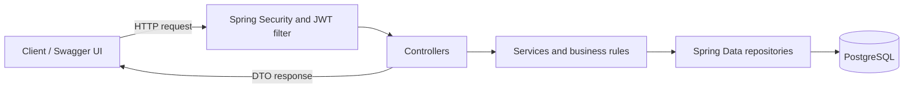
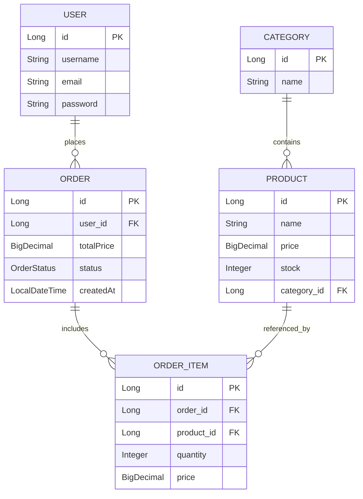
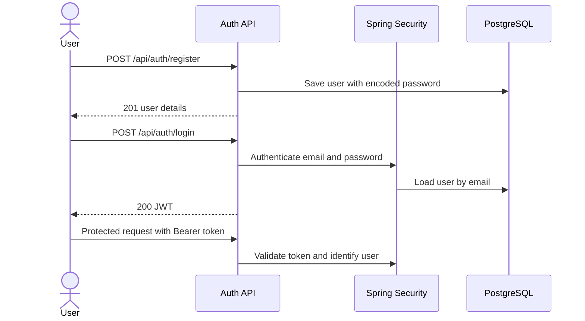
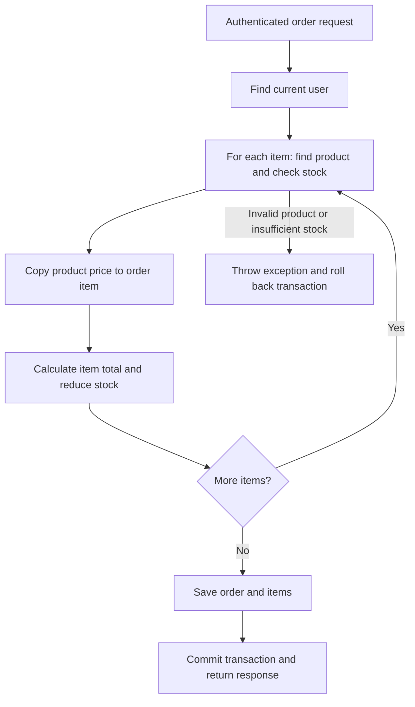

# MiniShop — Spring Boot Order API

MiniShop is a learning project for building a small shop backend with Spring Boot. Users authenticate with JWTs, manage categories and products, and create orders. The server calculates order totals, stores purchase prices, updates inventory, and keeps each user's order history private.

## Tech stack

- Java 17 and Spring Boot 4.1.1
- Spring Web MVC, Spring Security, Spring Data JPA, and Bean Validation
- PostgreSQL 17 and Docker Compose
- JWT authentication using JJWT
- OpenAPI and Swagger UI using springdoc
- Maven Wrapper, JUnit, and MockMvc

## Architecture



Controllers accept and validate requests. Services contain business rules, such as stock checks and order ownership. Repositories handle database access, while DTOs define the data exchanged with clients.

## Data model



An order belongs to one user and contains multiple order items. Each item references a product and stores its quantity and **price at purchase time**. If the product price later changes, the stored item price remains the original price.

## Getting started

### Prerequisites

- JDK 17 or later
- Docker and Docker Compose
- An available local port `5433` for PostgreSQL and `8080` for the API

The repository includes the Maven Wrapper, so a separate Maven installation is not required. Docker Compose runs PostgreSQL; the Spring Boot application runs locally.

### 1. Clone the repository

```bash
git clone https://github.com/iiMedR/MiniShop_SpringBoot.git
cd MiniShop_SpringBoot
```

### 2. Configure the environment

Create a `.env` file in the project root. It is read by Docker Compose and by Spring Boot's properties import:

```properties
PG_URL=minishop
PG_USER=minishop
PG_PASSWORD=choose-a-local-database-password
JWT_SECRET=replace-this-with-a-random-secret-at-least-32-bytes-long
```

`PG_URL` is the **database name**, not a full JDBC URL. `JWT_SECRET` is used as the UTF-8 signing key and must contain at least 32 bytes. Generate a strong random value for your own environment; don't commit or share it. The `.env` file is ignored by Git.

PostgreSQL's initialization settings apply when its data volume is first created. If you already have a volume, changing the values in `.env` does not automatically change the existing database or its credentials.

### 3. Start PostgreSQL and the application

From the project root:

```bash
docker compose up -d postgres
```

On Windows:

```powershell
.\mvnw.cmd spring-boot:run
```

On macOS or Linux:

```bash
./mvnw spring-boot:run
```

The Compose file maps host port `5433` to PostgreSQL port `5432` inside the container. The application connects to `localhost:5433`. Hibernate uses `ddl-auto=update` to create or update tables for local development.

- API base URL: `http://localhost:8080`
- Swagger UI: `http://localhost:8080/swagger-ui.html`
- OpenAPI JSON: `http://localhost:8080/v3/api-docs`

To stop the database container, run `docker compose stop postgres`. Its named volume keeps the data.

## Authentication

Register and log in to obtain a bearer token. Passwords are stored using BCrypt. JWTs expire after one hour, so log in again when a token expires.



### Register

`POST /api/auth/register` — no token required.

```json
{
  "username": "shopper",
  "email": "shopper@example.com",
  "password": "example-password"
}
```

Registration returns `201 Created` with the user's ID, username, and email; it does not return a token. Username must be 2–25 characters and password at least 8 characters.

### Login

`POST /api/auth/login` — no token required.

```json
{
  "email": "shopper@example.com",
  "password": "example-password"
}
```

The response has the form `{"token": "..."}`. Send it on protected requests:

```http
Authorization: Bearer <token>
```

In Swagger UI, click **Authorize**, paste the token into the bearer authentication field, and execute requests. Category, product, and order endpoints require authentication. There are no admin roles in this project: any authenticated user can manage categories and products.

## API endpoints

| Method | Path | Description | Success |
| --- | --- | --- | --- |
| POST | `/api/auth/register` | Register a user | 201 |
| POST | `/api/auth/login` | Log in and receive a JWT | 200 |
| POST | `/api/categories` | Create a category | 201 |
| GET | `/api/categories` | List categories | 200 |
| POST | `/api/products` | Create a product | 201 |
| GET | `/api/products` | List products with pagination and sorting | 200 |
| GET | `/api/products/{id}` | Get one product | 200 |
| PUT | `/api/products/{id}` | Update supplied product fields | 200 |
| DELETE | `/api/products/{id}` | Delete a product | 204 |
| POST | `/api/orders` | Create an order for the current user | 201 |
| GET | `/api/orders` | List the current user's orders | 200 |
| GET | `/api/orders/{id}` | Get an order belonging to the current user | 200 |
| PATCH | `/api/orders/{id}/cancel` | Cancel the current user's order | 200 |

### Categories and products

Create a category with `POST /api/categories`:

```json
{ "name": "Electronics" }
```

Use the returned category ID when creating a product with `POST /api/products`:

```json
{
  "name": "Mechanical Keyboard",
  "price": 600.00,
  "stock": 10,
  "categoryId": 1
}
```

The product name must not be blank, the price must be positive, the stock must be zero or greater, and the category must exist. The product update endpoint accepts `name`, `price`, and `stock`; fields omitted or set to `null` are left unchanged. It does not update the category.

#### Pagination and sorting

```http
GET /api/products?page=0&size=10&sort=price,asc
```

Pages are zero-based: `page=0` is the first page. `size` controls the requested number of items, and `sort` uses a product property and direction, for example `price,asc` or `name,desc`. The response is a Spring Data page object: products are in `content`, with metadata including `totalElements` and `totalPages`. Use actual property names when entering the sort value in Swagger.

### Create an order

`POST /api/orders` accepts product IDs and quantities. The client does not send a user ID, price, or total: the server uses the authenticated user and current product prices.

```json
{
  "items": [
    { "productId": 1, "quantity": 2 },
    { "productId": 2, "quantity": 3 }
  ]
}
```

The list must not be empty, each product ID must be supplied, and each quantity must be positive. Products must exist and have sufficient stock.



For example, two keyboards at 600 each and three mice at 200 each produce a total of 1,800. The corresponding stocks decrease by two and three. `@Transactional` groups order creation and stock changes together: if a later item fails, the earlier changes in the transaction are rolled back.

Example response (IDs and timestamp will vary):

```json
{
  "id": 1,
  "status": "CREATED",
  "totalPrice": 1800.00,
  "createdAt": "2026-10-18T16:00:00",
  "items": [
    { "productId": 1, "productName": "Keyboard", "quantity": 2, "price": 600.00 },
    { "productId": 2, "productName": "Mouse", "quantity": 3, "price": 200.00 }
  ]
}
```

### Order history and cancellation

Order lookups are scoped to the authenticated user. Requesting an order that does not exist or belongs to someone else returns `404`.

An order starts with status `CREATED`. `PATCH /api/orders/{id}/cancel` sets it to `CANCELLED` and restores the ordered quantities to product stock in a transaction. Cancelling an already cancelled order returns `409 Conflict`; sequential repeat requests do not restore stock again. A successful cancellation currently returns an empty `200 OK` response.

## Errors and validation

The global exception handler returns an `ErrorResponse` with `status`, `message`, and `timestamp` for handled application errors. Examples include `404` for missing products or orders, `409` for duplicate categories or repeated cancellation, and `400` for insufficient stock. Authentication failures return `401`. Validation and malformed JSON are handled by Spring; their response format can differ.

If Swagger reports a JSON parsing error, check that array entries are separated by commas. If a request returns an authentication error, verify that the bearer token is current and was copied correctly.

## Tests

The existing test suite checks application startup and JWT authentication, including valid, missing, malformed, expired, incorrectly signed, and deleted-user tokens. It requires the configured PostgreSQL database and JWT secret.

```powershell
.\mvnw.cmd -B test
```

On macOS or Linux, use `./mvnw -B test`. Order workflows and pagination can also be exercised through Swagger UI. Useful scenarios include checking order totals and purchase prices, testing ownership with two users, verifying stock rollback when a later item fails, and cancelling the same order twice.

## Project scope and future improvements

This project is intended for learning and local use. It does not include payments, shipping, roles, or refresh tokens. Potential next steps include automated integration tests for order workflows, database migrations, and concurrency controls for simultaneous orders or cancellations. The current stock and cancellation logic does not use locking or versioning, so concurrent requests are not guaranteed to preserve inventory correctly.
